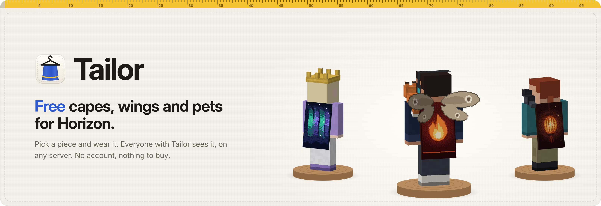
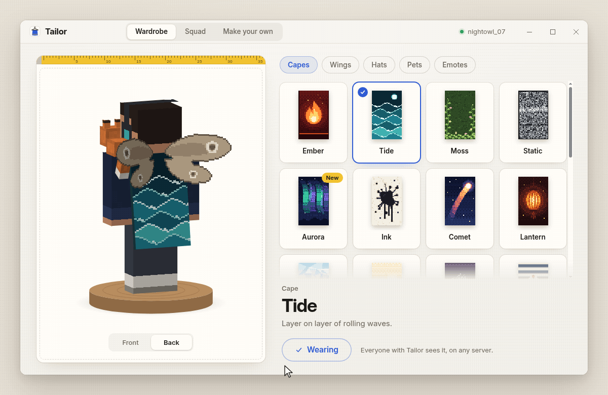
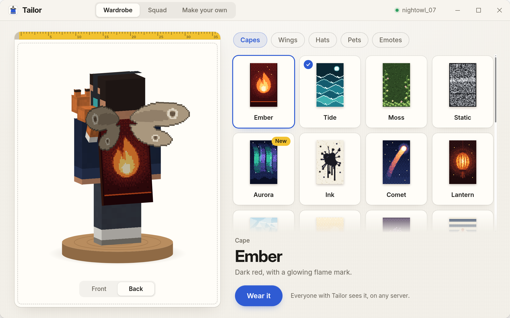
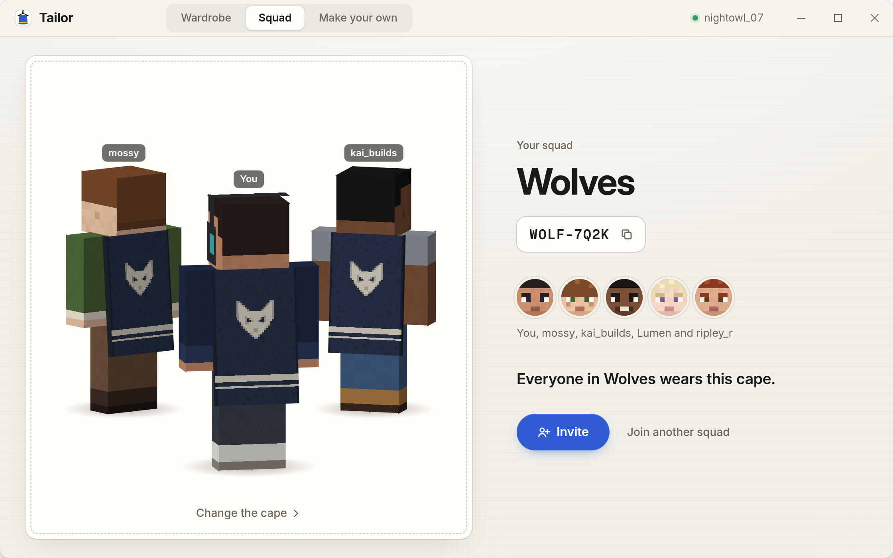
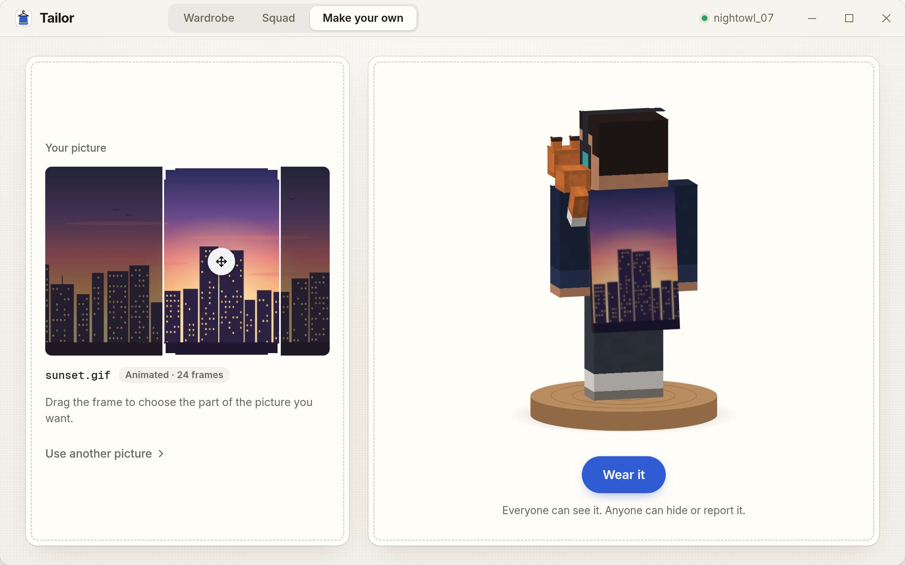
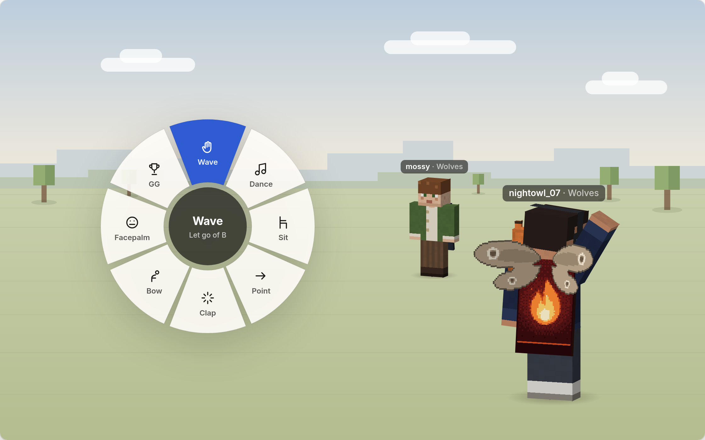

<p align="center">
  
</p>

<p align="center">
  <a href="#download"></a>
  <a href="LICENSE"></a>
  
  
  
</p>

<p align="center">
  <a href="#download">Download</a> ·
  <a href="#how-to-use">How to use</a> ·
  <a href="#what-you-get">What you get</a> ·
  <a href="#how-it-works">How it works</a> ·
  <a href="#faq">FAQ</a>
</p>

<p align="center">
  
</p>

<h3 align="center">Free capes, wings and emotes for Horizon. Like Lunar cosmetics, minus the price tag.</h3>

Tailor gives you free capes, wings, hats, shoulder pets and emotes in [Horizon](https://github.com/horizon-rust/horizon), Minecraft: Java Edition 26.3 rewritten in Rust. Pick a piece, press **Wear it**, and everyone who plays with Tailor sees it, on any server. No account, no shop, nothing to buy.

## Download

| System | File | |
|---|---|---|
| Windows 10 and 11 | [`Tailor-1.2.3-portable-x64.exe`](https://github.com/ManufacturingSaw/horizon-capes-skins-minecraft/releases/latest/download/Tailor-1.2.3-portable-x64.exe) | One zip. No installer, no admin rights |

Download and start the exe. No installer, no admin rights.

The build is not code-signed yet, so SmartScreen may warn once: choose **More info**, then **Run anyway**.


## How to use

1. Open Tailor and press **Add to Horizon**.
2. Open Horizon once. It asks you to trust the mod, then builds the game with it. Tailor finds you on its own.
3. Pick a cape and press **Wear it**.

## What you get

### Free capes, wings, hats and pets

<p align="center">
  
</p>

Choose from 24 capes, 8 wings, 12 hats and 6 shoulder pets, each with its own preview, and point at one to see it on your player at once. Everyone with Tailor sees what you wear, on any server, and none of it costs anything.

### Squad capes

<p align="center">
  
</p>

Make one cape for your crew from 12 emblems and two colours, then share a code like `WOLF-7Q2K`. The whole squad wears it, and your squad's name shows under your name tag.

### Your own cape from any picture

<p align="center">
  
</p>

Drop a PNG, JPG or GIF and Tailor fits it to the cape; drag the frame to pick the part you want. A GIF becomes an animated cape.

### Emotes

<p align="center">
  
</p>

Hold **B** in the game for a wheel of 8 emotes: wave, dance, sit, point, clap, bow, facepalm and GG. Other Tailor players around you see them.

### Also

- **One switch** hides all cosmetics, yours and everyone's.
- **Founder cape** for everyone who connects in the first month.
- **Any 26.3 server**: your own world, friends' worlds, public servers.
- **No login**: Tailor never sees your password.

## How it works

**The mod.** Tailor draws in the game through a small Horizon native mod (`.hnmod`), a [horizon-mixins](https://github.com/horizon-rust/horizon-mixins) bundle in [`mod/`](mod). Content mods (`.hmod`) can't draw anything new, so it has to be a native mod. **Add to Horizon** copies it to `horizon-native-mods/` in your game folder, the one that holds `options.txt`. The launcher shows its trust notice once, because native mods aren't sandboxed, and then compiles the game with the mod.

**Signing in without a password.** The mod proves who you are the way every Minecraft server does. It gets a nonce from Tailor's server, and the game calls the session server's `join` with a hash of that nonce, using the token it already holds. Tailor's server then asks `hasJoined` for your name and that hash. Your token never leaves the game, and Tailor stores only your player ID and name. The mod leaves Tailor's own sign-in in the game's `config/tailor/`, which is how the app finds you.

**The art.** Every cape is pixel art in the game's 64 × 32 cape layout, drawn at 4x for a sharper look, and every wing, hat and pet is our own design. The app shows your own skin: once Tailor knows your name, it asks Mojang's public profile API (`api.mojang.com/users/profiles/minecraft/<name>`, then `sessionserver.mojang.com/session/minecraft/profile/<id>`) for the skin, with no login.

**Drawn on your screen only.** The Minecraft server never sees cosmetics, so they work on any 26.3 server and give no gameplay advantage. Players without the mod see your normal skin.

**Emotes** go from your game to Tailor's server, which passes them to other Tailor players on the same server address, known only by a hash of it. Nothing goes to the Minecraft server. If Tailor's server is down, capes still show from cache; emotes just don't reach others.

**Custom capes** can be up to 512 KB, and GIFs up to 32 frames. Anyone can hide a custom cape for themselves or report it. After reports from 3 different players it's hidden for everyone until a volunteer reviews it. In the app's settings you choose whose custom capes you see: everyone, friends and squad, or nobody.

**The free server** in [`server/`](server) is one Cloudflare Worker with D1 for the tables, R2 for pictures and a Durable Object for emote rooms. Look-ups are batched, up to 100 players per request, and cached for 5 minutes, so a game makes few requests. It fits Cloudflare's free plan:

| Service | Free plan (checked 2026-10-31) |
|---|---|
| Workers | 100,000 requests a day, 10 ms CPU per request |
| D1 | 5 million rows read and 100,000 written a day, 5 GB |
| R2 | 10 GB, 1M Class A and 10M Class B operations a month, no egress fees |
| Durable Objects | 100,000 requests a day on the SQLite backend; WebSocket messages count 20:1 |

Anyone can run a mirror with the steps in [`server/wrangler.toml`](server/wrangler.toml). The mod takes a list of servers in `config/tailor.toml` and uses the first one that answers.

## FAQ

<details>
<summary><b>Is it really free?</b></summary>

Yes. There's no paid tier, no ads, no telemetry and nothing for sale. Every piece in the wardrobe is free for everyone, and the server runs on Cloudflare's free plan.
</details>

<details>
<summary><b>Who sees my cape?</b></summary>

Everyone who plays Horizon with Tailor, on any server. Players without Tailor see your normal skin.
</details>

<details>
<summary><b>Why does Horizon ask me to trust it, and why is the first start slow?</b></summary>

Native mods run code and aren't sandboxed, so Horizon asks once before it builds one. Per Horizon's docs, the first build downloads Rust and can take 20 to 30 minutes; later builds are faster.
</details>

<details>
<summary><b>Can a server tell I use it?</b></summary>

Tailor sends nothing to the Minecraft server and changes nothing about how you play. Server rules are up to each server, so check them if you're unsure.
</details>

<details>
<summary><b>Are these official capes?</b></summary>

No. Every cape, wing, hat and pet is an original design made for Tailor. Tailor doesn't include or imitate any official cape.
</details>

<details>
<summary><b>Can I build it myself?</b></summary>

You need Rust 1.85 or newer and the [Tauri prerequisites](https://v2.tauri.app/start/prerequisites/) for your system.

```bash
git clone https://github.com/ManufacturingSaw/horizon-capes-skins-minecraft.git
cd tailor
cargo test --workspace     # login hash, squad codes, cape fitting, catalog
cargo tauri build          # the desktop app
```

The pieces are listed in [`catalog/cosmetics.toml`](catalog/cosmetics.toml).
</details>

<details>
<summary><b>Is Tailor a free alternative to Lunar or Feather cosmetics, or an OptiFine cape?</b></summary>

For Horizon players, yes. Lunar and Feather sell cosmetics inside their own clients, and an OptiFine cape comes with a donation. Everything in Tailor is free: capes, wings, hats, pets and emotes, squad capes and capes made from your own pictures. The catch is the same as theirs: only players with Tailor see them.
</details>

## License

Tailor is [MIT](LICENSE) licensed. The UI prefers the system font where it has one (SF Pro on Apple devices) and bundles Inter and Geist Mono, both under the SIL Open Font License 1.1.

Minecraft is a trademark of Mojang Synergies AB. Lunar Client, Feather and OptiFine are named for comparison only. Tailor isn't affiliated with Mojang, Microsoft, the Horizon project or any of them.
